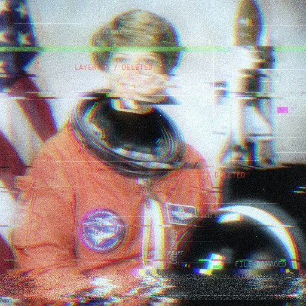
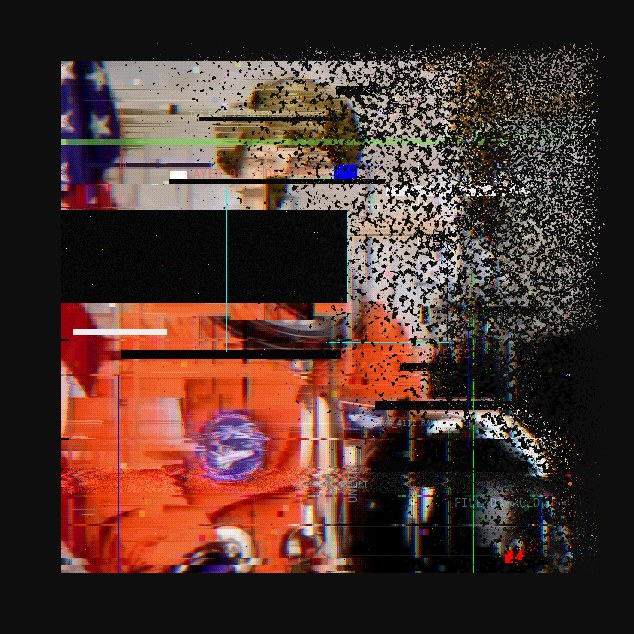
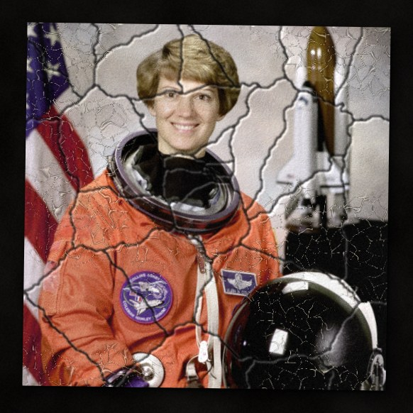
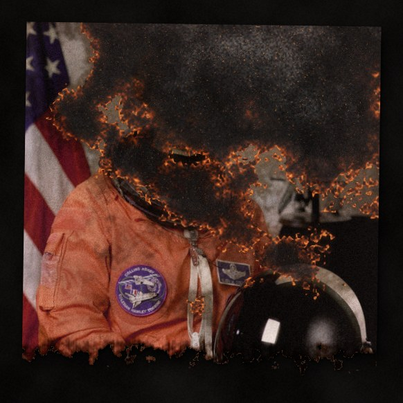
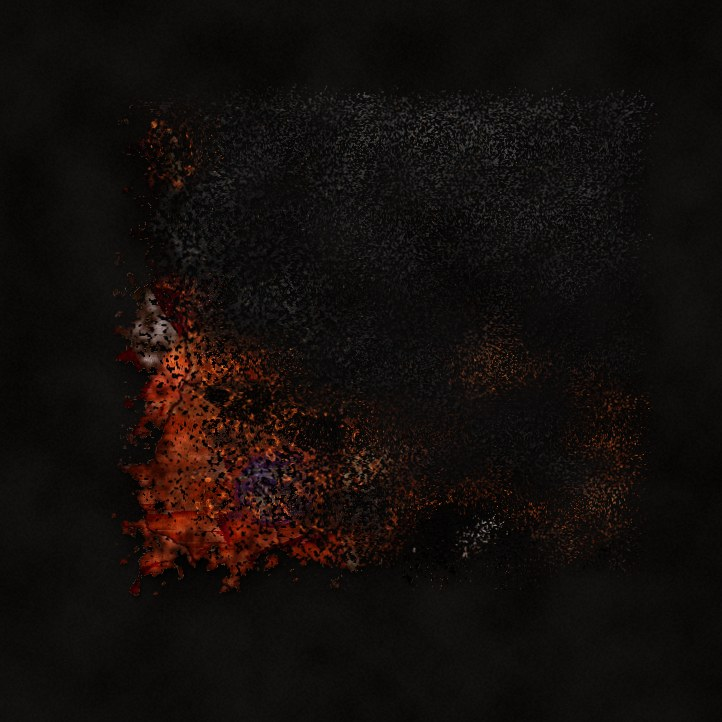

# PHOTO DESTROYER

Turn any photo into an old, broken, shredded or digitally destroyed one — and make the ruin look like art.

Three ways to use it, one engine: a **desktop app** (Tkinter), a **web app** (runs 100% in your browser, nothing is uploaded) and a **command line**.

| original | forgotten album | flooded archive | scorched |
|---|---|---|---|
|  |  |  |  |

| shredder: strips | shredder: confetti | digital kill | disintegration |
|---|---|---|---|
|  |  |  |  |

**Decay stages** — the same photo, 8 steps from untouched to ruined:

| aging | shredder | digital kill | obliterate |
|---|---|---|---|
|  |  |  |  |

**Digital kill lab (1.1):**

| datamosh | JPEG death | dead sector |
|---|---|---|
|  |  |  |

| signal lost | pixel storm | format C: |
|---|---|---|
|  |  |  |

*(sample photo: NASA astronaut portrait, public domain, via scikit-image)*

## Modes

**AGING** — what time does to a print: uneven dye fade, grain, water rings, rust foxing, mold, water warping, silvering in the shadows, creases with white cracks, craquelure, emulsion peeling off, dust and scratches, torn edges, ripped corners, burn marks, tape, white borders, and a table or archive card underneath.

**SHREDDER** — the print is fed through a paper shredder. The top stays intact, the rest hangs out of the slot as fanned, twisted strips while the cut-off ends pile up below. *Strip cut* or *Cross cut* (confetti). Sliders: amount, strip width, misalignment.

**DIGITAL KILL** — the file itself rots: pixel sorting, melting/dripping pixels, **datamosh** (drifting macroblocks and smeared columns), flipped bytes + deep-fry, **JPEG death** (chroma bleed, blocky tiles, wrong-coloured blocks), **dead pixels** (stuck lines, dead blocks, hot pixels), **bit crush** (a few dithered colours), disintegration into drifting particles, redaction bars and a secure-erase pass. 17 presets: *Datamosh, JPEG death, Dead sector, Bit rot, Signal lost, Pixel storm, Server fire, Deep fried, Redacted file, Ghost in the wire, CRT death, Memory leak, Format C:* and more. Combine with the **WIRED** group (glitch, channel split, VHS scan, ghost layer, overexposure, digital rot, system labels) for the lain-style "signal is dying" look.

**SHATTER** (1.1) — broken glass: the print splits into shards around an impact point, each slips and tilts, some fall out, dark seams with a glint run between them. Sliders: shatter, shard size, missing shards. 4 presets (*Broken glass, Smashed screen, Shattered mirror, Falling apart*).

**FIRE** (1.1) — a burn front eats the print from the edges: scorch and smoke ahead of it, a glowing ember line along it, grey ash and sparks behind it. Sliders: fire, embers, soot. 4 presets (*Burning photo, Slow burn, Inferno, Smoldering ash*).

**OBLITERATE** (1.1) — hard presets that stack everything until what is left is the destroyed copy: *Obliterate, Ground zero, Ashes, Nothing left, Evidence destroyed, Shattered and burned, Dead file, Memory hole*.

| broken glass | burning photo | obliterate |
|---|---|---|
|  |  |  |

The look is built to read as a physical object: dye fade that hits the edges and blotches first, lamp falloff and curl, lit paper-fibre relief, lost fine detail, then creases, craquelure, peeling emulsion and torn fibre edges on top.

Every effect is a 0–100 slider, the **Total decay** slider scales all of them (0–200 %), and every layout is deterministic per **seed** — moving one slider never re-rolls the damage of the others. **Decay stages** exports the same photo at N stages of destruction (PNG frames + GIF + contact strip), the "art of erasing the past" series.

## Desktop app

```bash
pip install -r requirements.txt
python app.py            # or: python app.py photo.jpg
```

`Ctrl+O` open · `Ctrl+S` save · `R` re-roll seed · `G` randomize · `1`-`6` mode · hold `Space` or press and hold the picture to see the original · double-click a slider to reset it · *Batch folder* processes a whole directory with the current settings.

Windows build: download `PhotoDestroyer-windows.zip` from the [Releases](https://github.com/DmitryLeLeE/photo_destoryer/releases) page (built by GitHub Actions on every `v*` tag), or run `build_exe.bat` (PyInstaller) yourself.

## Web app

Live version: **https://dmitrylelee.github.io/photo_destoryer/** (GitHub Pages; works with either the `/docs` or the root folder setting, the root `index.html` just redirects into `docs/`). Or open `docs/index.html` through any static server. Drag a photo in, or paste from the clipboard. 50 presets in a live-thumbnail filmstrip, collapsible slider groups, undo/redo (`Ctrl+Z`), a *Copy link* button that shares your exact settings, PNG/JPEG/WebP export, and a layout tested on phones, tablets, laptops and 4K screens (the preview stays pinned while you drag sliders on a phone). Keys: `G` random · `S` seed · `1-6` mode · `[` `]` previous/next preset · `Space` original. The engine runs in a Web Worker; nothing leaves your machine.

```bash
python -m http.server 8000 -d docs     # then open http://localhost:8000
```

## Command line

```bash
python cli.py photo.jpg -p "Forgotten album" -o out.png
python cli.py photo.jpg -p "Shredder: confetti" --seed 12
python cli.py photo.jpg --set fade=80 peel=40 sort=50 --tint cyan --backdrop dark
python cli.py --batch ./photos --out ./destroyed -p "Digital kill"
python cli.py photo.jpg --stages 6          # decay series: frames + GIF + strip
python cli.py --list-presets
```

## Project layout

```
app.py                 desktop GUI (Tkinter)
cli.py                 command line
destroyer/engine.py    the engine: numpy + Pillow only
destroyer/params.py    sliders and presets (single source of truth)
destroyer/stages.py    decay series export
docs/                  web version (engine.js is a port of engine.py)
tools/export_web_data.py   regenerates docs/data.js from params.py
```

After editing `destroyer/params.py`, run `python tools/export_web_data.py` so the web version gets the same sliders and presets.

## How it works

Pure numpy + Pillow, no scipy/OpenCV, so builds stay small. All sizes are relative to the image (`u = short side / 1000`), so a 900 px preview and a 4000 px export look the same. Each effect owns its own random stream. Craquelure is a warped Worley (cellular) network, tears are noisy half-planes with a fibrous paper rim, the shredder composites rotated strips and chips, and disintegration gathers pixels from a drifting offset field.

Pillow ≥ 10.1 and Python ≥ 3.9 are required.
