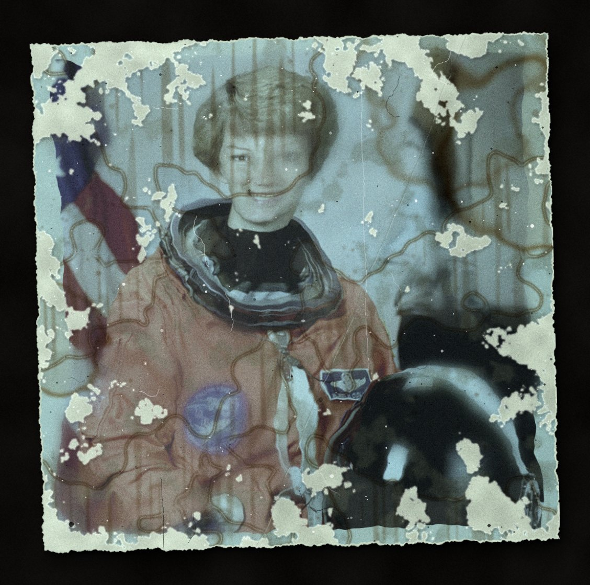
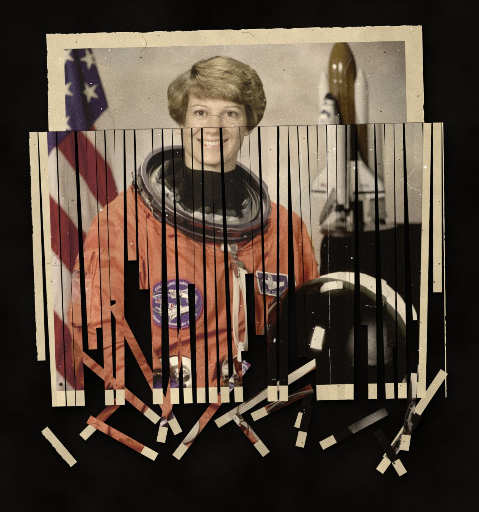
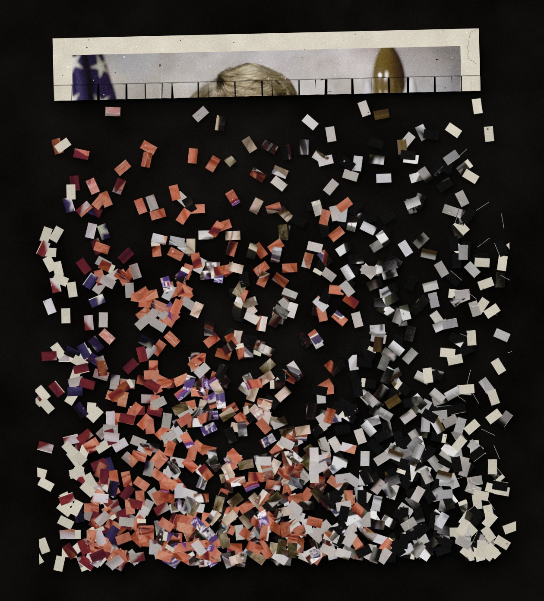
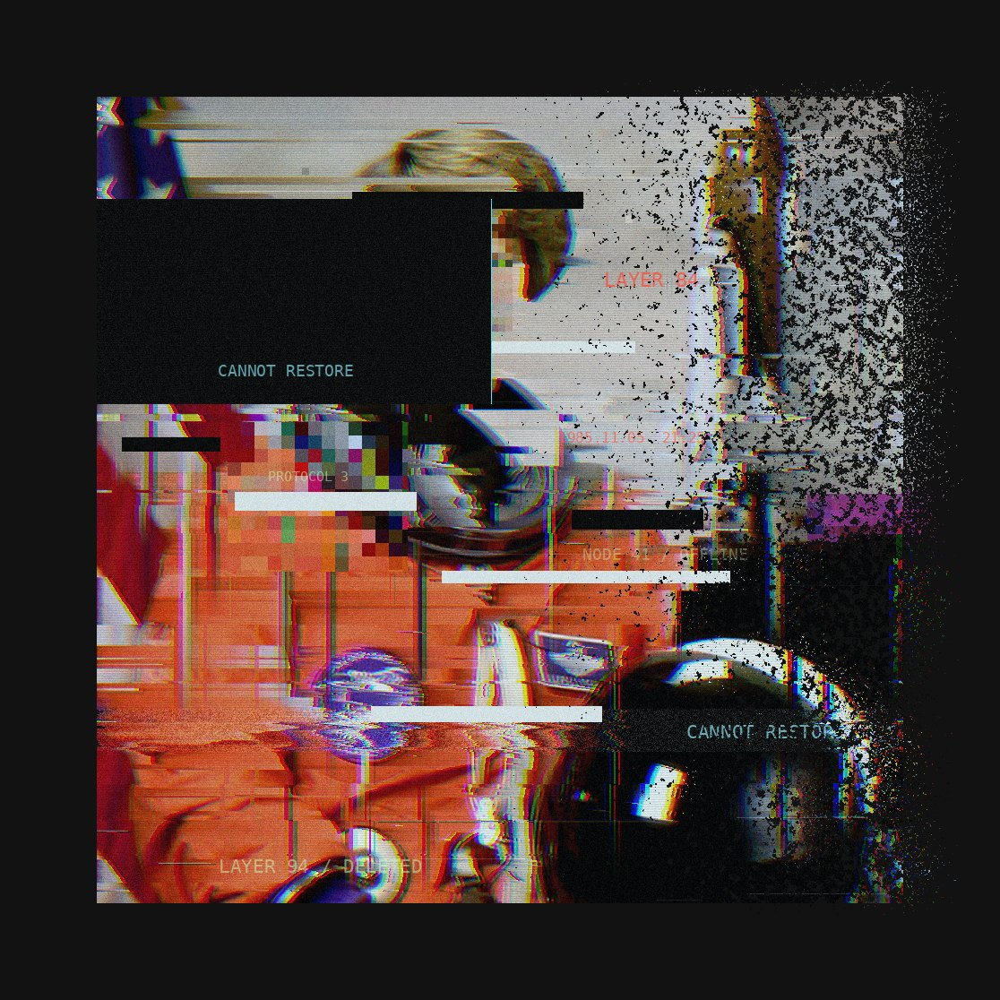
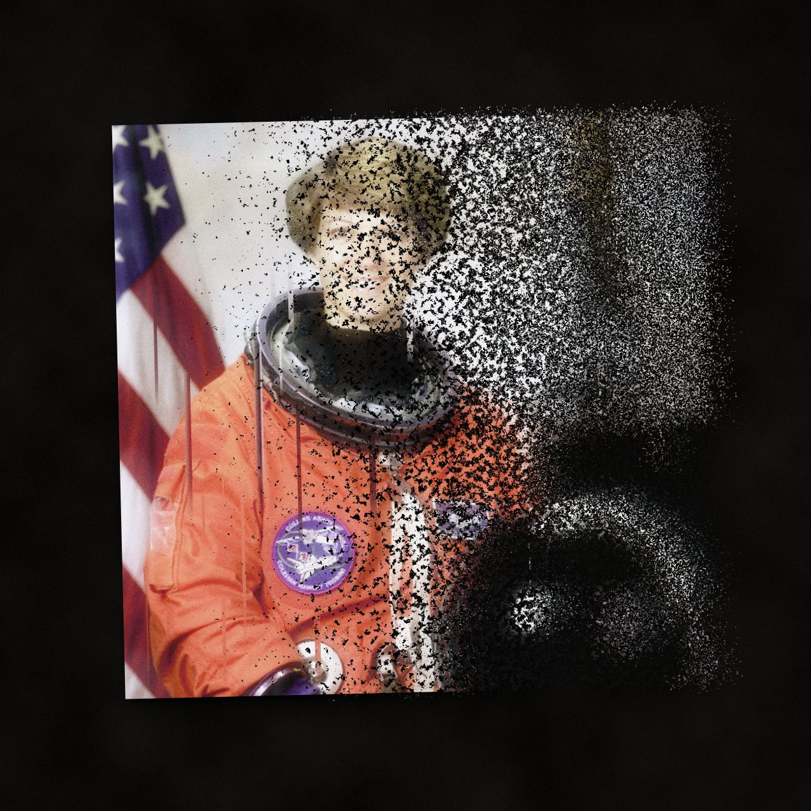

# PHOTO DESTROYER

Turn any photo into an old, broken, shredded or digitally destroyed one — and make the ruin look like art.

Three ways to use it, one engine: a **desktop app** (Tkinter), a **web app** (runs 100% in your browser, nothing is uploaded) and a **command line**.

| original | forgotten album | flooded archive | scorched |
|---|---|---|---|
|  |  |  |  |

| shredder: strips | shredder: confetti | digital kill | disintegration |
|---|---|---|---|
|  |  |  |  |

*(sample photo: NASA astronaut portrait, public domain, via scikit-image)*

## Modes

**AGING** — what time does to a print: uneven dye fade, grain, water rings, rust foxing, mold, water warping, silvering in the shadows, creases with white cracks, craquelure, emulsion peeling off, dust and scratches, torn edges, ripped corners, burn marks, tape, white borders, and a table or archive card underneath.

**SHREDDER** — the print is fed through a paper shredder. The top stays intact, the rest hangs out of the slot as fanned, twisted strips while the cut-off ends pile up below. *Strip cut* or *Cross cut* (confetti). Sliders: amount, strip width, misalignment.

**DIGITAL KILL** — the file itself rots: pixel sorting, melting/dripping pixels, flipped bytes + deep-fry, disintegration into drifting particles, redaction bars and a secure-erase pass. Combine with the **WIRED** group (glitch, channel split, VHS scan, ghost layer, overexposure, digital rot, system labels) for the lain-style "signal is dying" look.

Every effect is a 0–100 slider, the **Total decay** slider scales all of them (0–200 %), and every layout is deterministic per **seed** — moving one slider never re-rolls the damage of the others. **Decay stages** exports the same photo at N stages of destruction (PNG frames + GIF + contact strip), the "art of erasing the past" series.

## Desktop app

```bash
pip install -r requirements.txt
python app.py            # or: python app.py photo.jpg
```

`Ctrl+O` open · `Ctrl+S` save · `R` re-roll seed · hold `Space` to see the original · *Batch folder* processes a whole directory with the current settings.

Windows build: run `build_exe.bat` (PyInstaller).

## Web app

Open `docs/index.html` through any static server, or enable **GitHub Pages** (Settings → Pages → Branch `main`, folder `/docs`) and it is live at `https://<user>.github.io/photo_destoryer/`. Drag a photo in, or paste from the clipboard. The engine runs in a Web Worker; nothing leaves your machine.

```bash
python -m http.server 8000 -d docs     # then open http://localhost:8000
```

## Command line

```bash
python cli.py photo.jpg -p "Forgotten album" -o out.png
python cli.py photo.jpg -p "Shredder: confetti" --seed 12
python cli.py photo.jpg --set fade=80 peel=40 sort=50 --tint cyan --backdrop dark
python cli.py --batch ./photos --out ./destroyed -p "Digital kill"
python cli.py photo.jpg --stages 6          # decay series: frames + GIF + strip
python cli.py --list-presets
```

## Project layout

```
app.py                 desktop GUI (Tkinter)
cli.py                 command line
destroyer/engine.py    the engine: numpy + Pillow only
destroyer/params.py    sliders and presets (single source of truth)
destroyer/stages.py    decay series export
docs/                  web version (engine.js is a port of engine.py)
tools/export_web_data.py   regenerates docs/data.js from params.py
```

After editing `destroyer/params.py`, run `python tools/export_web_data.py` so the web version gets the same sliders and presets.

## How it works

Pure numpy + Pillow, no scipy/OpenCV, so builds stay small. All sizes are relative to the image (`u = short side / 1000`), so a 900 px preview and a 4000 px export look the same. Each effect owns its own random stream. Craquelure is a warped Worley (cellular) network, tears are noisy half-planes with a fibrous paper rim, the shredder composites rotated strips and chips, and disintegration gathers pixels from a drifting offset field.

Pillow ≥ 10.1 and Python ≥ 3.9 are required.
